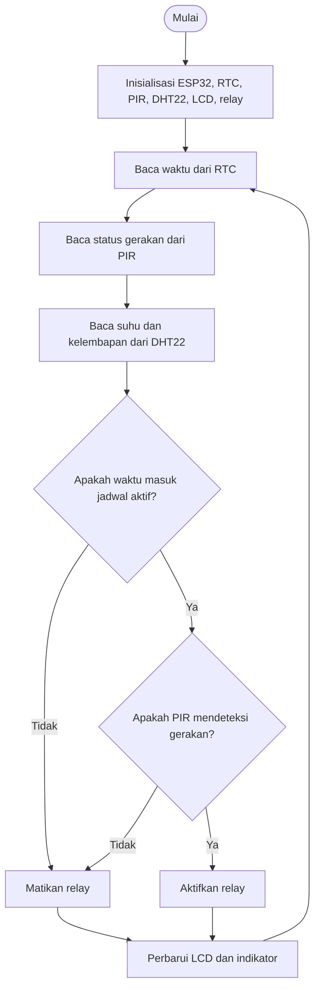

# Flowchart Sistem

Diagram berikut menggambarkan logika utama pengendalian relay berdasarkan jadwal RTC dan deteksi gerakan PIR.

## Penjelasan

1. ESP32 menginisialisasi seluruh komponen.
2. RTC menyediakan waktu untuk memeriksa jadwal.
3. PIR memberikan status deteksi gerakan.
4. DHT22 membaca suhu dan kelembapan sebagai pemantauan lingkungan.
5. Relay aktif hanya jika jadwal aktif **dan** PIR mendeteksi gerakan.
6. LCD dan indikator diperbarui sesuai implementasi program, lalu proses berulang.

Catatan: diagram ini menjelaskan logika yang direncanakan. Cocokkan detail tampilan dan indikator dengan versi akhir `sketch.ino`.
